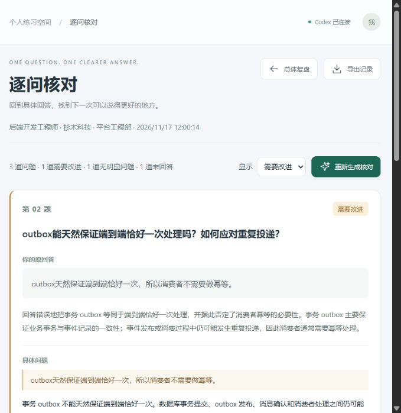

# 基于codex的AI面试室

一款面向 Windows 的桌面语音模拟面试工具。通过本机 **Codex app-server** 调用你当前配置的模型，围绕真实项目追问，并在面试后生成复盘、逐题核对与答疑。

仓库地址使用英文名称 `Codex-Based-AI-Interview-Room`，项目中文名称为「基于codex的AI面试室」。

## 主要功能

- **基于项目提问**：选择本地项目目录，让 Codex 只读了解项目背景，围绕实现细节、技术取舍和个人贡献展开面试。
- **岗位与团队设置**：填写目标岗位、公司、部门、个人背景、岗位要求和面试风格，调整问题重点与追问节奏。
- **中文语音交互**：使用 Windows 本机语音组件识别回答、朗读面试官发言；识别结果可手动修正，也可直接输入文字。
- **暂停与悬浮小窗**：支持暂停、手动发送回答和小窗面试，便于对照项目思考。
- **复盘与逐题核对**：保留原始问答，区分合理回答、待改进回答、未回答和证据不足，给出具体分析与参考说法。
- **针对问题继续答疑**：结合本场面试背景，就某道题或整场面试继续提问。
- **本机保存与导出**：面试记录保存在本机，可回看并导出 Markdown。

## 界面预览




## 运行条件

1. Windows 系统，并已安装可用的 Codex；应用优先发现 Microsoft Store 桌面版附带的 Codex，其次发现 npm 安装版。
2. Codex 已完成模型配置，并能正常发送请求。应用沿用当前 Codex 配置，无需在项目中填写 API 密钥；CC Switch 是可选的配置管理方式。
3. 从源码运行时需安装 Node.js 与 npm。开发验证使用 Node.js 24。
4. 使用中文语音功能时，Windows 需具备中文语音识别器和中文朗读声音；麦克风与摄像头由用户主动开启。

## 从源码启动

```powershell
git clone https://github.com/lqqzeishuai-hash/Codex-Based-AI-Interview-Room.git
cd Codex-Based-AI-Interview-Room
npm ci
npm start
```

## 开始面试

1. 打开「面试设置」，填写目标岗位。公司、部门为选填项，也可补充个人职责、岗位要求与面试风格。
2. 选择要讨论的本地项目目录。可选「读取本机会话」，基于已有 Codex 本地会话创建面试分支；原会话不会被修改。
3. 点击「开始语音面试」，根据界面提示开启语音交互，或直接在「你的回答」中输入文字。面试官只朗读最终发言，工具事件不会被朗读。
4. 自动发送的停顿等待默认是 3.2 秒，可在设置中调整，也可点击「我说完了」手动发送。播放面试官发言时会停止语音识别，避免录入自身声音。
5. 需要思考时点击暂停。面试官区域右上角的「进入小窗」可切换为悬浮面板，在小窗中发送回答、控制麦克风、暂停或结束面试。
6. 结束后查看总体复盘，进入「面试记录」回看或导出 Markdown。

## 逐题核对与答疑

从总体复盘、面试记录或左侧「逐问核对」进入，点击「生成逐问核对」。每道题保留面试官问题和你的原回答：合理回答正常显示；需要改进的回答会引用具体原话、解释问题并给出参考说法；没有回答或证据不足会分别标记。可筛选需要改进的题目。

点击「针对这道题提问」，在右侧继续问原因、例子或回答方式，也可选择「整场面试」。答疑使用本场保存的岗位、公司、部门、个人背景、岗位要求、实际问答及核对结果；修改下一场设置不会改变旧场次的背景。

核对与答疑会保存在本机，导出的 Markdown 包含总体复盘、逐题核对与答疑。核对时会只读获取所选项目 README 的前 24 KB，模型也可按需只读核实相关实现。生成可以停止，中断后支持重试；参考回答中的假设与待补充项应按真实经历调整。

## 配置与数据

- 模型调用经过本机 Codex app-server；应用不另存 API 密钥，不修改 Codex 或 CC Switch 配置。
- 默认读取 `%CODEX_HOME%/config.toml`；未设置 `CODEX_HOME` 时由 Codex 使用默认用户配置。
- 更换模型配置后，先结束当前面试，再点击侧栏「重新加载配置」。配置在重新连接时生效，面试过程中不会隐式重启 Codex。
- 可通过环境变量 `AI_INTERVIEW_CODEX_BIN` 指定 `codex.exe` 路径。
- 设置和面试记录默认保存在 Electron 用户数据目录，可通过 `AI_INTERVIEW_DATA_DIR` 自定义。
- 被面试项目使用 Codex 的只读沙箱，审批策略为 `never`，不允许写入或提权。工具事件展示前会过滤常见密钥格式。
- 中文识别和朗读由 Windows 本机 `System.Speech` 组件提供，不另行调用云端语音服务。
- 用户回答，以及 Codex 按需读取的项目背景，会发送到用户当前配置的模型服务。
- Git 仓库不包含依赖目录、便携版构建产物、本机面试数据、验证日志与本机快捷方式。

## 动画形象、摄像头与功能边界

- 内置面试官是会眨眼、随朗读活动嘴部的 SVG 动画形象。
- 摄像头为可选的本机预览：不录制、不发送给模型、不分析表情。摄像头预览不代表模型具备视频理解能力。
- 公司和部门用于调整模拟面试场景；没有公司资料时不会伪造内部规则。
- 中文识别准确度取决于麦克风、环境和 Windows 语言组件；识别结果可以修改。本机识别语言目前是中文。
- 每轮等待时间取决于模型服务和 Codex 工具调用；首题可能需要额外时间读取项目。
- 支持本地工作区、AGENTS.md、本地 Skills 和可用 MCP；桌面宿主独有的插件、云端会话、连接器不保证自动继承。
- 参考时长仅用于提醒，不会在倒计时结束时自动中断回答。
- 关闭时已完成问答保存在本机；历史记录可回看和导出，暂不支持中断面试的跨进程恢复。

## 开发与验证

| 命令 | 用途 |
| --- | --- |
| `npm start` | 启动 Electron 桌面应用 |
| `npm run preview` | 启动本机界面预览，仅监听 127.0.0.1 |
| `npm run check` | 检查 JavaScript 语法与必需资源 |
| `npm test` | 运行单元测试 |
| `npm run test:integration` | 验证真实 Codex、Windows 语音、复盘、核对与答疑 |
| `npm run test:context` | 验证本地会话上下文能力 |
| `npm run dist` | 打包 Windows x64 便携版 |

正式使用请运行桌面应用。界面预览用于验证与桌面版共用的界面，不替代桌面程序的窗口与设备能力。

真实集成验证会使用当前模型产生请求，读取临时虚构项目并生成追问、复盘、逐题核对与答疑，可能产生模型服务费用。验证证据保存在本机 `qa/` 目录。测试不要求人对麦克风讲话，也不会自动开启摄像头。

验证中新建的 Codex 临时会话应在完成后删除；不得删除用户原有会话或正在使用的主对话。

## 打包便携版

```powershell
npm ci
npm run dist
```

打包产物位于 `release/`，文件名为 `AI-Interview-Studio-<版本号>-Windows.exe`。双击即可运行，无需另外安装 Node.js；本机仍需有可用的 Codex 配置与相应 Windows 语音组件。

## 目录说明

```text
src/              桌面主进程、界面、Codex 接入与本机语音组件
scripts/          预览、检查和集成验证脚本
test/             自动化测试
docs/images/      界面截图
README.md         项目说明
使用说明.md       详细使用说明
AGENTS.md         开发约定
```
